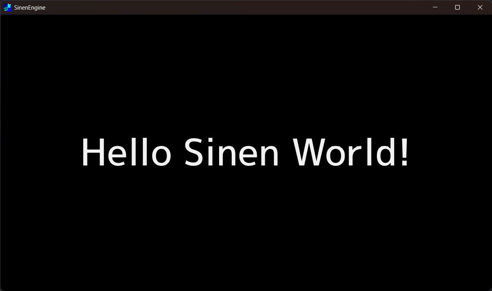

# Sinen

Sinen は Luau と Slang を使うクリエイティブコーディング向けのフレームワークです。

<p align="center"><a href="https://astomih.github.io/sinen"></a></p>

## 最初のプログラム

```luau
local sn = require("@sinen")
local font: sn.Font = sn.Font.new(32)

function draw()
	sn.Graphics.drawText(
		"Hello World!",
		sn.TextStyle.new(font, sn.Color.new(1.0), 32),
		sn.TextTransform.new(sn.Window.center(), 0.0, sn.Pivot.Center)
	)
end
```



## ビルド

submodule を初期化したら、xmake で Sinen を設定してビルドできます。Windows の MSVC 2026 Debug の例です。

```bat
git submodule update --init --recursive
xmake f -p windows -a x64 -m debug --vs=2026 --sinen_webgpu_dawn=y -o build/msvc2026-debug
xmake build --all
```

`build\generate_msvc2026-debug.bat` と `build\build_msvc2026-debug.bat` を使うと、構成ごとの xmake 設定が保存されます。Android と Emscripten も `build\generate_*.bat` と `build\build_*.bat` でビルドできます。Android の Slang ビルドには Windows 側で生成するホストツールが必要です。Emscripten の `generate_emscripten.bat` は、任意の引数として同梱するアセットのディレクトリを受け取ります。

SDL、Assimp、KTX、Slang、Windows の Dawn は、xmake が固定された submodule の CMake 定義を使って準備します。そのため、対象プラットフォームのツールチェーンに加えて CMake と Ninja が必要です。

## ゲーム

リポジトリを VS Code で開き、**実行とデバッグ**から **Games** を選択して **F5** を押します。Debug 実行ファイルがまだない場合は、先に `generate_msvc2026` と `build_msvc2026` のタスクを実行してください。マウス、矢印キー、またはゲームパッドでゲームを選べます。ゲームのメニューでは **Q** でセレクターに戻ります（RIDGELINE では **B** も使えます）。

[FOUNDRY](game/fps/README.md) は工業施設のドローン格納庫を舞台にした、シングルプレイの PBR FPS です。

[RIDGELINE](game/racing/README.md) はアナログゲームパッド操作に対応した PBR サーキットレースです。

## ドキュメント

[](https://github.com/astomih/sinen/actions/workflows/documents.yml)

[Sinen ドキュメント](https://astomih.github.io/sinen)

ローカルでプレビューするには、Python の仮想環境を有効にし（CI は Python 3.13）、リポジトリのルートから以下を実行します。

```sh
cd docs
python -m pip install -r requirements-docs.txt
zensical serve
```

静的サイトを `docs/site/` に生成するには、`docs/` で `zensical build --clean` を実行します。GitHub Pages には GitHub Actions から公開します。初回設定時は **Settings → Pages → Source** を **GitHub Actions** に設定してください。
