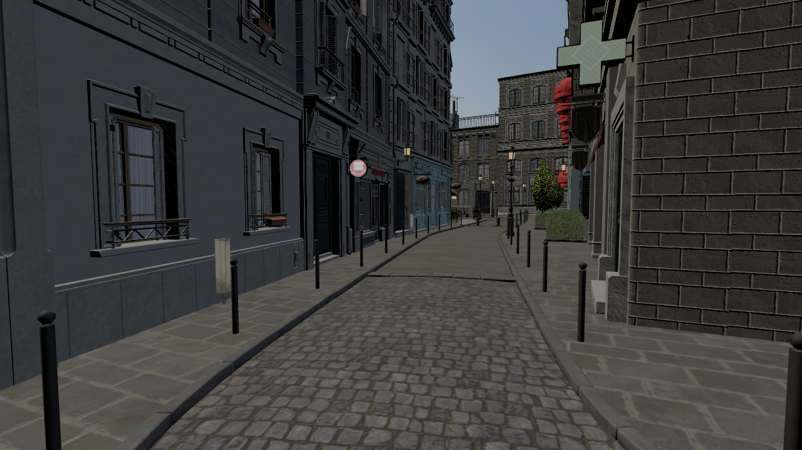

# Bistro: advanced graphics

Amazon Lumberyard's **Bistro Exterior** loaded directly from the original FBX,
with PBR materials, alpha-tested foliage, HDR reflections and real-time probe GI.



Scene: **Amazon Lumberyard Bistro**, [NVIDIA ORCA](https://developer.nvidia.com/orca/amazon-lumberyard-bistro),
Amazon Lumberyard, July 2017, [CC BY 4.0](https://creativecommons.org/licenses/by/4.0/).
The screenshot is an engine render. The original license and README are copied
beside the local assets.

## Download original assets

From the repository root:

```powershell
./examples/graphics/bistro/prepare.ps1
```

This downloads the official **Bistro v5.2** archive (about **853 MiB**), verifies
its SHA-256, extracts it under the ignored build directory, and copies the
original exterior FBX, DDS textures, HDR panorama and license into
`assets/Bistro_v5_2/`. It performs no conversion or mesh splitting and requires
no Blender installation. Allow a few GB of disk space.

Existing downloads/extractions can be reused:

```powershell
./examples/graphics/bistro/prepare.ps1 -Archive C:/Assets/Bistro_v5_2.zip
./examples/graphics/bistro/prepare.ps1 -SourceDirectory C:/Assets/Bistro_v5_2
```

On other platforms, copy `BistroExterior.fbx`, `Textures/`,
`san_giuseppe_bridge_4k.hdr`, `LICENSE.txt` and `README.txt` from the official
extraction into this example's `assets/Bistro_v5_2/` directory.

Start the examples launcher and choose **Graphics → Bistro (Advanced)**.
The loading screen waits for model import and external texture loads before GI
starts. Large assets are ignored by Git. Initial loading uses substantially more
memory than the small examples.

## Direct model loading

```luau
local model = sn.Model.new("assets/Bistro_v5_2/BistroExterior.fbx", {
    maxTextureSize = 1024,
    packedSpecular = true,
    flipNormalY = true,
    staticScene = true,
})
-- In draw(), PBRRenderer binds every part's material automatically.
renderer:drawModel(pass, model, transform)
```

The static model importer preserves every mesh placement and material from the
FBX node hierarchy. It applies node transforms, FBX axis/unit metadata, normals,
UVs and vertex colors, then builds internal draw parts. No intermediate GLB,
manifest, PNG, EXR or proxy file is generated. PBR frustum-culls imported parts
and shares texture objects between materials referencing the same file.
`isReady()`, `getPartCount()`, `getMaterialCount()` and `getTriangleCount()` expose
loading status and scene statistics. Existing animated/skinned import retains
its previous animation path; this hierarchy/material extension is for static
models. `staticScene` bakes the authored node pose when a file also contains
animation tracks, as Bistro does; skinned meshes retain the animation path.

`maxTextureSize` selects a suitable DDS mip or resizes a decoded image during
loading (zero preserves full resolution). The DDS decoder supports 2D BC1–BC5
UNORM and masked RGB/RGBA images, including mip chains. BC6/BC7, arrays,
cubemaps and signed BC4/BC5 are unsupported.

ORCA's legacy `Specular` DDS stores occlusion in R, roughness in G and metalness
in B. `packedSpecular` explicitly opts into this convention. BC5 normal Z is
reconstructed by PBR; `flipNormalY` selects the source's DirectX convention.
Base-color alpha uses a 0.5 cutoff for this scene. Glass is approximated with
alpha testing. The HDR panorama is loaded directly for IBL; `sky.slang` applies
an SDR display mapping to the background.

## Controls

| Input | Action |
| --- | --- |
| Hold right mouse / arrow keys | Look around |
| W / A / S / D | Move horizontally |
| Q / E | Move down / up |
| Left Shift | Faster movement |
| R | Restore the author's camera |
| G | Toggle local indirect light |
| P | Animate the sun; GI follows the lighting change |
| Z / X | Decrease / increase exposure |
| F10 | Save `bistro.png` after a 40-frame history warmup |
| Escape | Return to Graphics examples |

`capture.luau` is an alternative entry point that captures the author's camera
and exits. Captures freeze movement and omit the HUD.

## Real-time GI

In `ready()`, `gi:addModel(model, transform, nil, nil, 40000)` creates an
approximate GI proxy **in memory** using meshoptimizer. The budget is distributed
among imported parts; small parts retain a minimum of geometry, so it is a
simplification target rather than a strict global cap. Alpha-masked parts are
omitted to avoid opaque leaf-card occluders. Mean texture colors and vertex
colors approximate diffuse reflectance; emissive maps supply emitted radiance.

The static proxy/BVH is registered once. A **12 × 6 × 12** local probe volume
traces **64 GPU rays per probe per frame**, up to **2 diffuse hits**, with a
history weight of **0.88**. The 64 m wide volume recenters with the camera and
resets temporal history. The tracer evaluates the sun and constant sky; PBR
retains HDR specular IBL and a weaker blue directional fill. GI is a diffuse
approximation and does not provide full-resolution ray-traced direct shadows.

The original v5.2 FBX imports as **2,832,120 triangles**, **132 used materials**
and **1,591 internal parts**. On an RTX 4070 Ti SUPER, the Windows Release/D3D12
build measured about **60 FPS at 1280 × 720** with GI enabled (180 frames after
warmup, VSync enabled). This is a machine-specific observation, not an uncapped
GPU timing or a guarantee for other hardware.

`sky.frag.snb` contains SPIR-V, SPIR-V 1.3, WGSL and DXIL variants; the shader
compiler plugin is not required to run the example.
