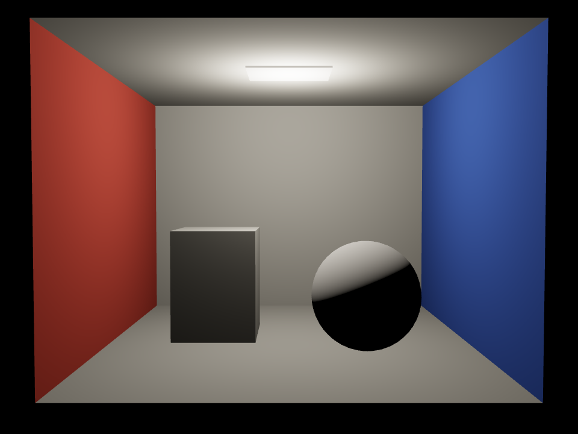
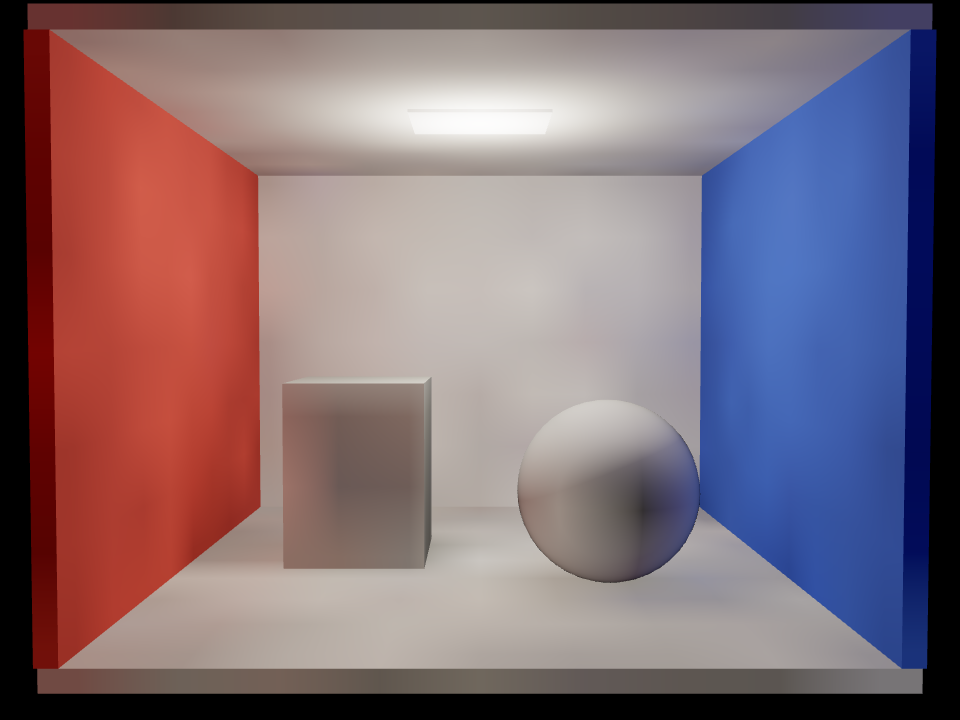

# リアルタイムのグローバルイルミネーション

サンプルランチャーで **Graphics → Global Illumination** を開きます。シーンは手続き的に生成するため、アセットのダウンロードや実行時のシェーダーコンパイラプラグインは不要です。事前ベイクも行いません。光源と球体は常に動き、間接光は GPU で毎フレーム再計算されます。

| 直接光のみ | 直接光とリアルタイム GI |
| --- | --- |
|  |  |

これらの PNG は Direct3D 12 でエンジンが描画した実際の 960 × 720 画像です。赤と青の壁の色が無彩色のオブジェクトや床に映り込みます。直接光が当たらない球体の下面も、プローブボリュームによって照らされます。

- **Space:** 間接光の切り替え。
- **P:** 動く光源と球体の一時停止・再開。
- **S:** 現在のシーンディレクトリに `direct.png` と `gi.png` を再生成。
- **Esc:** サンプルランチャーに戻る。

`main.luau` が対話型サンプルを実行します。`capture.luau` は両方の PNG を書き出して終了する別のエントリーポイントで、どちらも同じ `scene.luau` を使います。キャプチャでは動きを止めて時間履歴を 32 フレーム蓄積し、画像のシーン状態を揃えます。

```luau
local gi = sn.GlobalIllumination.new()
assert(gi:initializeRealtime(minimum, maximum, 9, 7, 9, 3))
renderer:setGlobalIllumination(gi, 1.0)

-- 各フレームで、レンダーパスを開始する前に実行:
gi:beginFrame() -- 照明の履歴を保ちながらジオメトリを更新します。
for _, object in objects do
    gi:addModel(object.model, object.transform, sn.Color.new(0.8))
end
gi:setLight(light) -- 現在の DirectionalLight、PointLight、SpotLight をコピーします。
assert(gi:update(0.85))
-- 通常どおり renderer:drawModel(...) で描画します。
```

CPU はジオメトリが変わると三角形の BVH を構築します。コンピュートシェーダーはその BVH をたどり、プローブごとに毎フレーム **64 本のレイ**を追跡します。直接光のシャドーテスト、発光、色付きの拡散反射バウンスを評価します。GPU 上のソフトウェアレイトレーシングなので、専用のレイトレーシングハードウェアは不要です。各プローブは 64 スレッドのワークグループを使い、6 方向の放射照度を保存します。シェーダーが新しいサンプルと前フレームを混合し、GPU のバッファからテクスチャへコピーして HDR アトラスを更新します。更新時に CPU への読み戻しや明示的な GPU のアイドル待ちはありません。レイ判定、積分、時間フィルタリングは GPU、ジオメトリ変換と BVH 構築は CPU で実行します。

PBR シェーダーは近傍の 8 プローブを補間し、面の法線に応じて 3 方向の成分を組み合わせます。マテリアルの拡散 BRDF、金属度、オクルージョン、露出を適用します。IBL がある場合、局所 GI は環境光の拡散成分を置き換え、鏡面反射は維持します。

このサンプルは 9 × 7 × 9 プローブを使い、各レイで拡散反射を最大 3 回評価します。一次レイは毎フレーム計 36,288 本で、これに二次レイとシャドーレイが加わります。球体には小さめのメッシュを GI プロキシとして使います。開発用マシンの MSVC Debug ビルドと Direct3D 12 でアニメーションを 300 フレーム測定したところ、表示同期込みで平均約 60 FPS でした。これはシーン全体の測定で、GPU だけの処理時間や性能保証ではありません。

`initializeRealtime` は各軸 2～32 個のプローブ、1～4 回の拡散反射を受け取ります。既定値は 8 × 6 × 8 個と 2 回です。境界は端のプローブを含み、有限で正の範囲が必要です。無効な設定では以前のボリュームを維持します。リアルタイム更新は Direct3D 12、Vulkan、WebGPU に対応します。SDL GPU は現在 `false` を返します。WebGPU には通常の実行時依存関係が必要で、Dawn が Direct3D 12 を選ぶ場合は DXC も必要です。コンピュートバンドルは SPIR-V、SPIR-V 1.3、WGSL、DXIL を含みます。シェーダーコンパイラプラグインが必要なのはバンドルを再生成するときだけです。

照明だけが変わる場合は登録済みジオメトリを維持し、新しい光源または空の色を設定して `update` を呼びます。ジオメトリが動く場合は `beginFrame` を呼び、関係するジオメトリを現在の変換で登録し直してから `update` を呼びます。アトラスはその場で更新されるため、レンダラーへの接続は一度で済みます。ボリュームを再初期化した後は再接続してください。履歴の重みは 0～0.99 に制限され、`0` は現在のフレームだけを使います。既定の 0.85 はノイズを平滑化しつつ、数フレームで変化へ追従します。`clear` はジオメトリ、照明、GPU の状態をリセットします。

これは粗い方向情報を保存する拡散 GI です。読み込んだテクスチャ、スキニング、透過、鏡面反射の伝搬はレイトレーサーで評価しません。モデルの読み込み完了後に登録し、テクスチャ付きアセットには代表的な線形色の拡散反射率と発光色を指定してください。頂点カラーは指定した反射率に乗算されます。既存の PBR の直接光処理は変わらず、GI のシャドーレイが影響するのは反射光で、直接光の影ではありません。

粗いプローブ格子では薄い壁から光が漏れたり、固体内部のプローブで描画が乱れたりする場合があります。ボリュームを利用するシーン空間に収め、小さな形状の周辺は格子を密にし、無関係な部屋をまたがないようにしてください。境界外のサンプリングは端のプローブに固定されます。時間フィルタリングは急な変化に遅れるため、履歴の重みを下げると滑らかさと引き換えに応答が速くなります。接続済みのボリュームで強度を 0 にすると、直接光だけの比較用に環境の拡散光を無効化します。`clearGlobalIllumination` で通常の環境光・IBL に戻せます。

静的シーン向けの CPU の `bake(...)` API も引き続き利用できます。`isBaked()` と `sampleIrradiance(position, normal)` はその CPU の結果を参照します。リアルタイムボリュームは GPU 上にあり、`isRealtime()` で識別できます。
